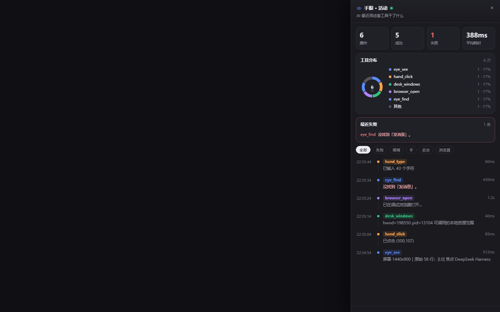

# dsh-handeye

DeepSeek Harness（dsh）插件：把 **手（真实鼠标键盘）**、**眼（屏幕投影）**、**后台控件操作（UIA）**、**浏览器 CDP 通道** 合成一个，给 AI 用，不绑定任何模型厂商。

> An agent-facing computer-use toolbox for DeepSeek Harness on Windows: projected screen reading, real mouse/keyboard input, background UI Automation control, and a CDP browser channel.

设计原则一句话：**能用后台控件就不用鼠标，能按名字就不用坐标，能投影就不喂原文。**

---

## 它提供什么

### 看（感知，不花鼠标）

| 工具 | 用途 |
|---|---|
| `eye_see` | 看屏并投影。L0 一句话（这是什么界面、几个可点入口），L1 区块+控件+粗坐标，L2 全量。OCR 默认 **2 倍放大**（小字中文识别率明显不同），要快才传 `scale=1` |
| `eye_find` | 按文字找位置（OCR） |
| `eye_changed` | 只问"屏幕变了没有"，走图像指纹，不做 OCR，最便宜 |
| `eye_shot` | 截图存成 PNG，**只返回路径**，图片不进对话 |
| `eye_text` | 文字瘦身：去重、去噪、保头保尾、报警行不丢 |

### 手（动作，会动鼠标）

| 工具 | 用途 |
|---|---|
| `hand_click` | 按坐标点击 |
| `hand_click_text` | 按文字点击（先 UIA 再 OCR），可带 `expect` 验证 |
| `hand_type` | 输入文字，支持中文，不占剪贴板 |
| `hand_key` | 按键 / 组合键 |
| `hand_focus` | 把窗口切到前台 |

### 后台控件操作（不碰鼠标，不抢前台）

| 工具 | 用途 |
|---|---|
| `desk_windows` | 列出所有窗口（hwnd / pid / 标题 / 类名 / 位置） |
| `desk_tree` | 读 UIA 控件树，每个节点带 `ref` |
| `desk_find` | 按名字/automationId 找控件，返回 ref |
| `desk_invoke` | 按控件（按钮、勾选、列表项、展开菜单），鼠标不动 |
| `desk_set_value` | 往输入框写值（ValuePattern），不按键、不占剪贴板 |
| `desk_focus` | 把键盘焦点移到控件 |
| `desk_text` | 直接读控件树里的文字，比 OCR 准 |
| `desk_launch` | 启动程序 / 打开文件或网址 |
| `desk_batch` | 一次进程内跑 1–20 个动作，出错即停 |

### 网页（按元素，不猜坐标）

| 工具 | 用途 |
|---|---|
| `browser_open` | 用独立配置目录的 **Chrome（优先）/ Edge** 打开网址，窗口放屏幕外，不抢焦点 |
| `browser_snapshot` | 列出页面里所有可交互元素，每个带 `#序号` |
| `browser_click` | 按序号点，页面内派发指针/鼠标/click 三段事件，React/Vue 也认 |
| `browser_fill` | 按序号写值，走原生 setter 并触发 input/change，会更新框架状态 |
| `browser_text` | 读页面可见文字（标题 + 网址 + 正文），不用 OCR |
| `browser_navigate` | 同一个标签页里跳转 |
| `browser_tabs` / `browser_close` | 列出 / 关闭标签页 |
| `browser_stop` | 关掉整个调试浏览器实例（只按自己的配置目录认人，不碰你正常用的浏览器） |

### 记账

| 工具 | 用途 |
|---|---|
| `yl_log` | 查 handeye 七段系统日志（谁点了什么、为什么失败） |

共 **29 个工具**。

---

## 给人看的活动面板

AI 到底干了什么，右侧抽屉里一眼看完：



- **KPI 一行**：操作数 / 成功 / 失败 / 平均耗时
- **工具分布**：环形图 + 图例（按工具计数），一眼看出这次偏重眼睛还是手
- **最近失败**：失败调用单独一张卡，红字列出工具和原因
- **时间线**：每次调用一行，带工具色标、耗时、两行摘要；点击展开参数和完整输出
- **筛选**：全部 / 失败 / 眼睛 / 手 / 后台 / 浏览器
- 收起后留在右上角一枚小挂件，显示最近一次工具名和总次数；点它展开

数据来自插件自己的只读路由 `/dsh-handeye/activity`（同源、不带凭证、只在内存里）。
配色直接吃 DSH 的 `--dsw-alias-*` 变量，深浅主题都能贴合宿主。

---

## 装

```powershell
# 在 DSH 终端里，把 <本仓库路径> 换成实际目录
dsh plugin --profile desktop add file:<本仓库路径>
```

也可以在插件市场/插件页里选本地目录安装。

依赖：**自带一份 `bin/handeye.exe`，不需要另装**。查找顺序：

1. 环境变量 `HANDEYE_EXE`
2. 插件目录下的 `bin\handeye.exe`（默认走这条）

handeye 的源码在 [Alan-dot-C/MouseRobot](https://github.com/Alan-dot-C/MouseRobot)。

PowerShell 用系统自带的 5.1，也不需要装别的东西。平台：**Windows**。

**改完源码要重新安装一次**：DSH 的 profile 是复制而非软链，改文件不会自动生效。

```powershell
dsh plugin --profile desktop remove dsh-handeye
dsh plugin --profile desktop add file:<本仓库路径>
```

---

## 三级投影是怎么定的

- **投影，不是摘要**：只删不编，同输入必然同输出，不调用模型。
- **报警通道永不降采样**：对话框、错误词、数字变化行、新窗口，任何级别都原样给。预算被报警行吃满时，预算让位。
- **L0 那句话是脸**：`[L0] 焦点「…」| 界面 32 块（content×32）| 可点 0 项 | 原始 79 行`

实测：同一屏 79 行 OCR → L0 一行。

---

## 什么时候用哪个

| 场景 | 用 |
|---|---|
| 标准 Windows 程序（计算器、设置、Office、资源管理器） | `desk_tree` → `desk_invoke` / `desk_set_value` |
| 自绘界面（微信、Chrome、Electron、Qt） | `hand_click_text` 或 `eye_see` + 坐标 |
| 只想确认"有没有变" | `eye_changed` |
| 要看图（图表、画布、复杂对话框） | `eye_shot` 拿路径，交给能看图的模型 |
| 长日志/长文档要进上下文 | `eye_text` 先瘦身 |

---

## 已知边界

- **UIA 取决于程序有没有实现**。Win32/XAML/UWP 一般没问题；Chrome 默认只给一层 Pane，读网页要走 CDP。部分环境（例如某些 WinForms 控件、新版记事本的 XAML 岛）`desk_set_value` / `read-text` 会读不到，得退回 `desk_focus` + `hand_type` 或 `eye_see`。
- **后台点击不是万能的**。有些控件只有 InvokePattern 能用、有些只认鼠标，`desk_invoke` 会明确告诉你"这个控件没有可用的模式"。
- **浏览器通道是独立配置**：它不带用户的登录态，需要登录的站点要在那个窗口里自己登一次。Chrome 136+ 起，带默认用户目录的远程调试会被禁用，所以插件只用自己的临时配置目录。
- **会抢键鼠**。`hand_*` 和 `desk_*` 不要和别的自动化工具同时跑。

---

## 路线

- v0.1：手 + 看 + 后台控件操作，20 个工具
- v0.2：加浏览器 CDP 通道，共 28 个工具
- v0.3：OCR 默认 2 倍放大；修投影层（L0 不再谎报"可点 0 项"、L1 超预算只砍尾巴）；加投影单测
- v0.4：活动面板重做成右侧抽屉（KPI + 工具分布环 + 失败卡 + 可筛选时间线）；浏览器启动不再带 NTP/同步页；新增 `browser_stop`；失败调用会被如实标记
- v0.5（当前）：浏览器默认优先 Chrome；`browser_stop` 同时认 Chrome/Edge；文档整理与开源准备
- v0.6：`zoom` 下钻（按 ref 取 L2 而不重新截屏）、词化指令代理

---

## 测试

投影层是纯函数，用 `node:test` 回归，不依赖 handeye 和屏幕：

```powershell
# 有 node 时：
npm test
# 没有 node、但装了 DSH 桌面端时，用 Electron 自带的 node：
$env:ELECTRON_RUN_AS_NODE=1; & '<DSH 安装目录>\DeepSeek Harness.exe' --test test/project.test.mjs
```

覆盖：L0 自绘界面提示、真实按钮不误报、对话框/错误词报警、L1 超预算保头保报警只砍尾巴、正文按面积优先。

`experimental/pixel-diff.py` 是未接线的像素差分原型（连通域标出变化区域，需要 pillow + numpy），留给 v0.6 的 `zoom` / diff 下钻，不是运行时依赖。

---

## 许可与致谢

代码 MIT。动作层 `handeye` 来自 [Alan-dot-C/MouseRobot](https://github.com/Alan-dot-C/MouseRobot)；
后台控件操作的思路借鉴了 [dsh-computer-use-win](https://github.com/Yu-tao-Li/dsh-computer-use-win)；
活动面板的视觉语言参考了 [dsh-context](https://github.com/bowenliang123/dsh-context)。
